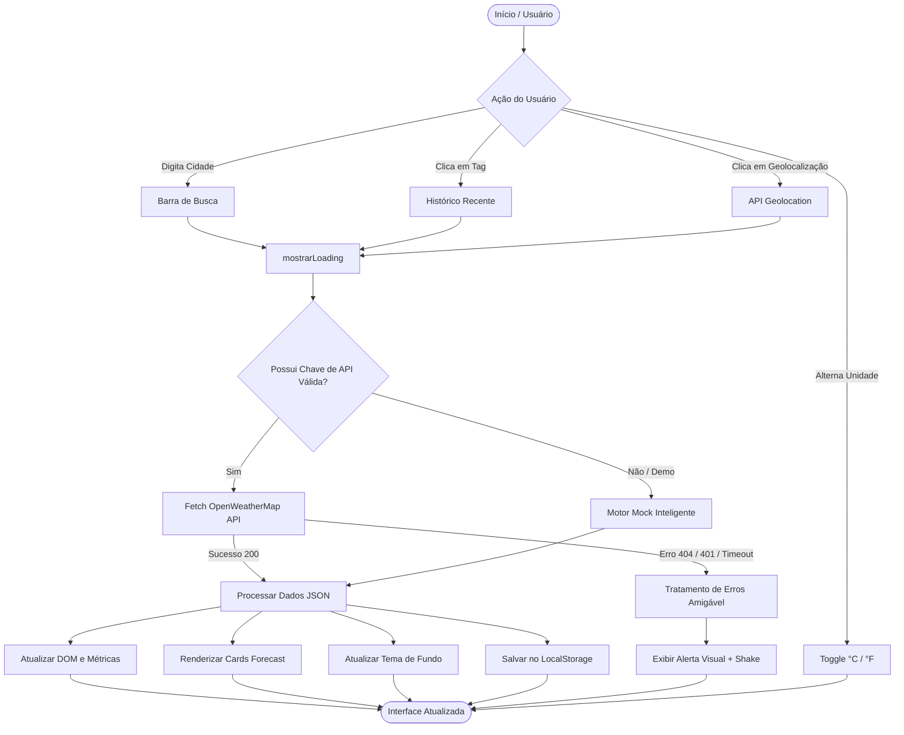

<div align="center">

# ☁️ ClimaTempo — Previsão Meteorológica em Tempo Real

> Uma aplicação web moderna, responsiva e resiliente para consulta meteorológica em tempo real, construída com JavaScript ES6+, Glassmorphism UI e integração com a OpenWeatherMap API.

<p align="center">
  
  
  
  
  
  
</p>

[🖼️ Preview do Projeto](#-preview-do-projeto) •
[✨ Funcionalidades](#-funcionalidades-principais) •
[🏗️ Arquitetura](#-arquitetura--fluxo-de-dados) •
[🚀 Como Executar](#-como-executar-o-projeto) •
[🧪 Testes](#-testes-automatizados) •
[👨‍💻 Autor](#-autor)

---

</div>

## 🖼️ Preview do Projeto

<div align="center">
  
</div>

---

## 💻 Sobre o Projeto

O **ClimaTempo** é uma aplicação Front-End de alta performance projetada para fornecer dados climáticos precisos e em tempo real para qualquer localização global. 

A interface utiliza **Glassmorphism UI** (efeito de vidro translúcido com `backdrop-filter` e bordas luminosas), complementada por **fundos dinâmicos reativos** que adaptam suas cores e animações de acordo com a condição climática retornada (sol, chuva, nublado, tempestade, neve ou noite).

Conta também com um **Motor de Fallback Inteligente (Modo Demonstração)**, garantindo resiliência total mesmo sem chave de API ou em ambientes offline.

---

## ✨ Funcionalidades Principais

| Ícone | Recurso | Descrição |
| :---: | :--- | :--- |
| 🔍 | **Busca Global Instantânea** | Consulta dados de qualquer cidade do mundo em milissegundos. |
| 📍 | **Geolocalização em 1 Clique** | Identifica a localização atual do usuário via `navigator.geolocation`. |
| 🌡️ | **Alternador de Unidades (°C / °F)** | Conversão dinâmica e em tempo real entre Celsius e Fahrenheit. |
| 🕒 | **Previsão Estendida (Forecast)** | Carrossel horizontal com cards da previsão para os próximos dias/horários. |
| 🎨 | **Atmosfera e Temas Adaptativos** | Fundo gradiente muda automaticamente conforme as condições do clima. |
| 📜 | **Histórico de Buscas Recentes** | Chips de acesso rápido salvos no `localStorage` para navegação ágil. |
| ⚙️ | **Gerenciador de API Key na UI** | Modal acessível para configurar sua chave OpenWeatherMap direto no navegador. |
| 🛡️ | **Tratamento Resiliente de Erros** | Alertas amigáveis para 404 (cidade não encontrada), 401 (chave inválida) e offline. |
| ⏳ | **Loading State Elegante** | Indicador giratório com micro-animação durante as requisições assíncronas. |

---

## 🎨 Temas Dinâmicos por Clima

A aplicação analisa os códigos de condição da API e ajusta os gradientes do plano de fundo em tempo real:

| Condição | Classe CSS | Gradiente de Fundo |
| :--- | :--- | :--- |
| ☀️ **Céu Limpo** | `.clima-limpo` | `#1a2a6c` ➔ `#b21f1f` ➔ `#fdbb2d` |
| 🌧️ **Chuva** | `.clima-chuva` | `#2c3e50` ➔ `#3498db` ➔ `#2980b9` |
| ☁️ **Nublado** | `.clima-nuvens` | `#373b44` ➔ `#4286f4` ➔ `#525252` |
| ⛈️ **Tempestade** | `.clima-tempestade` | `#141e30` ➔ `#243b55` ➔ `#4b134f` |
| ❄️ **Neve** | `.clima-neve` | `#606c88` ➔ `#3f4c6b` ➔ `#e0eafc` |
| 🌙 **Noite** | `.clima-noite` | `#050505` ➔ `#111e2e` ➔ `#1a2a3a` |

---

## 🏗️ Arquitetura & Fluxo de Dados



---

## 📁 Estrutura de Diretórios

```bash
app-previsao-do-tempo/
├── assets/
│   ├── css/
│   │   └── style.css            # Design System, Glassmorphism, temas e responsividade
│   └── js/
│       └── script.js            # Lógica ES6+, Fetch API, Mock Engine e estado da aplicação
├── images/
│   └── preview.png              # Imagem de preview da aplicação
├── tests/
│   └── app.test.js              # Suíte de testes automatizados de validação
├── .gitignore                   # Arquivos ignorados pelo controle de versão
├── index.html                   # Estrutura HTML5 semântica e acessível
├── README.md                    # Documentação técnica completa
└── SKILLS-A-INSTALAR.MD         # Diagnóstico técnico e guia de skills para agentes
```

---

## 🚀 Como Executar o Projeto

### 1. Clonar o Repositório
```bash
git clone https://github.com/ViktorGabriel/app-previsao-do-tempo.git
cd app-previsao-do-tempo
```

### 2. Abrir a Aplicação
- Basta abrir o arquivo `index.html` em seu navegador de preferência.
- Ou use extensões como o **Live Server** no VSCode para recarregamento automático.

### 3. Configurar sua Chave OpenWeatherMap (Opcional)
O aplicativo já vem pronto para uso com o **Modo Demo Inteligente**. Para usar dados reais da sua conta:
1. Crie uma conta gratuita em [OpenWeatherMap](https://openweathermap.org/api) e obtenha sua API Key.
2. Abra o app e clique no ícone de **Engrenagem (⚙️)** no canto superior direito.
3. Cole sua chave e clique em **Salvar Chave**.

---

## 🧪 Testes Automatizados

A aplicação inclui uma suíte de testes de validação técnica cobrindo integridade de arquivos, seletores DOM, tratamento de requisições e estilização.

Para executar os testes com Node.js:

```bash
node tests/app.test.js
```

**Resultado esperado:**
```text
🧪 Iniciando testes de validação...
  ✅ PASS: Arquivo index.html deve existir
  ✅ PASS: Arquivo assets/css/style.css deve existir
  ✅ PASS: Arquivo assets/js/script.js deve existir
  ✅ PASS: Arquivo README.md deve existir
  ✅ PASS: index.html deve importar fonte Poppins
  ✅ PASS: index.html deve conter input de cidade
  ✅ PASS: index.html deve conter botão de geolocalização
  ✅ PASS: index.html deve conter alternador de unidade
  ✅ PASS: index.html deve conter spinner de loading
  ✅ PASS: index.html deve conter componente de alerta de erro
  ✅ PASS: script.js não deve ter duplo ponto e vírgula na URL
  ✅ PASS: script.js deve usar AbortController para timeout seguro
  ✅ PASS: script.js deve utilizar localStorage para persistência
  ✅ PASS: script.js deve conter fallback mock resiliente
  ✅ PASS: script.js deve suportar geolocalização
  ✅ PASS: style.css deve conter estilos de Glassmorphism
  ✅ PASS: style.css deve conter tema de fundo para chuva
  ✅ PASS: style.css deve conter tema de fundo para céu limpo

📊 Resultado: 18 passaram, 0 falharam.
```

---

## 🛡️ Boas Práticas & Resiliência Implementadas

- **Segurança Client-Side:** Uso estrito de `textContent` / `innerText` para prevenção de injeção XSS.
- **Resiliência Assíncrona:** Controle de timeout via `AbortController` evitando deadlocks em redes móveis instáveis.
- **Armazenamento Seguro:** Preferências de unidade, histórico e credenciais isoladas em `localStorage`.
- **Acessibilidade & Tipografia:** Importação otimizada da fonte Google Fonts *Poppins* e ícones FontAwesome com atributos semânticos.

---

## 👨‍💻 Autor

Desenvolvido por **Viktor Gabriel Gonçalves de Oliveira**.

Distribuído sob a licença **MIT**. Consulte o arquivo para mais informações.