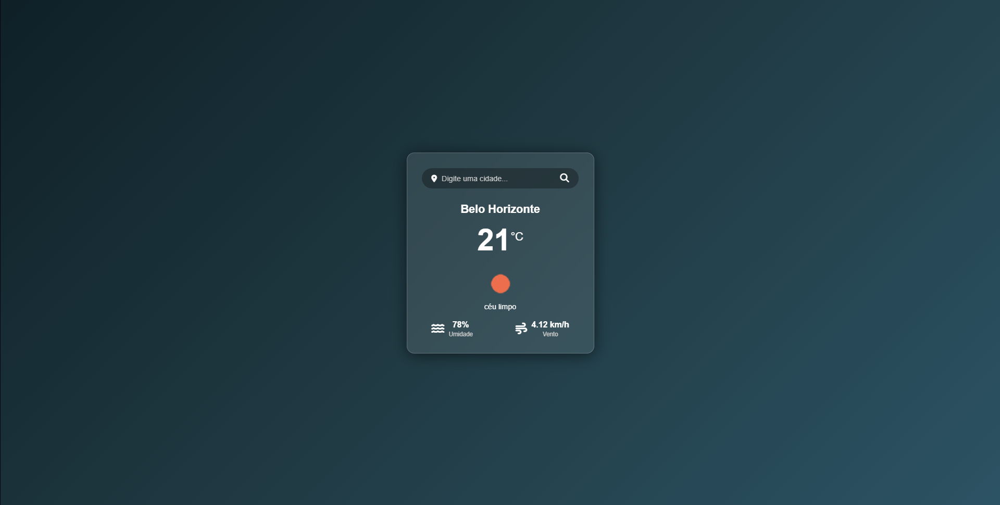

# ☁️ App de Previsão do Tempo (Weather App)

> Uma aplicação web moderna e resiliente para consulta meteorológica em tempo real, construída com JavaScript ES6+ e Glassmorphism UI.


## 🖼️ Preview do Projeto



---

## 💻 Sobre o Projeto

Este projeto é uma aplicação **Front-End de alta performance** que permite aos usuários consultar a previsão do tempo de qualquer cidade do mundo em tempo real. A interface foi redesenhada seguindo os princípios de **Glassmorphism**, com micro-animações, fundos adaptativos de acordo com o clima e suporte a dispositivos móveis.

A aplicação conta com um sistema resiliente de **fallback inteligente (Modo Demo/Mock)**, garantindo que o app nunca quebre mesmo que a chave de API ainda não tenha sido informada ou haja instabilidade de rede.

---

## ✨ Funcionalidades Principais

- 🔍 **Busca em Tempo Real:** Consulta rápida por qualquer cidade do mundo via API da OpenWeatherMap.
- 📍 **Geolocalização Automática:** Botão dedicado para obter o clima da sua localização atual em 1 clique (`navigator.geolocation`).
- 🌡️ **Alternador de Unidades (°C / °F):** Alternância dinâmica e instantânea entre Celsius e Fahrenheit salva em `localStorage`.
- 🕒 **Previsão Estendida:** Carrossel com previsão do tempo para as próximas horas / dias.
- 📜 **Histórico de Buscas:** Acesso rápido às últimas cidades pesquisadas com tags clicáveis.
- 🎨 **Temas Dinâmicos por Clima:** O fundo gradiente e a iluminação da interface reagem ao clima atual (Céu limpo, Chuva, Nublado, Tempestade, Neve ou Noite).
- ⚙️ **Gerenciador de API Key na UI:** Modal para inserir e salvar sua chave da OpenWeatherMap no navegador sem necessidade de alterar o código-fonte.
- 🛡️ **Resiliência e Tratamento de Erros:** Alertas visuais amigáveis para cidade não encontrada (404), chave inválida (401), sem internet ou tempo limite excedido.
- ⏳ **Loading State:** Animações de carregamento (spinner) elegantes durante requisições assíncronas.

---

## 🛠️ Tecnologias Utilizadas

- **HTML5:** Estrutura semântica, acessível e otimizada.
- **CSS3:**
  - **Glassmorphism UI** avançado (`backdrop-filter`, `rgba`, bordas luminosas).
  - Gradientes dinâmicos adaptativos com micro-animações.
  - Design 100% responsivo (Mobile First).
  - Tipografia Google Fonts (`Poppins`).
- **JavaScript (ES6+):**
  - **Fetch API & AbortController:** Requisições assíncronas com controle de timeout.
  - **LocalStorage API:** Persistência de preferências de unidade, histórico e credenciais.
  - **Mock Data Engine:** Motor de demonstração local offline.
- **OpenWeatherMap API:** Dados climáticos em tempo real e previsão de 5 dias.

---

## 🚀 Como Executar o Projeto

1. **Clone o repositório:**
   ```bash
   git clone https://github.com/ViktorGabriel/app-previsao-do-tempo.git
   ```

2. **Abra a aplicação:**
   - Basta abrir o arquivo `index.html` em qualquer navegador web moderno.
   - Ou utilize uma extensão como o *Live Server* no VSCode.

3. **Configuração da API Key (Opcional):**
   - O aplicativo já inicia funcionando em **Modo Demonstração Inteligente**.
   - Para dados 100% em tempo real da OpenWeatherMap:
     1. Obtenha uma chave gratuita em [OpenWeatherMap](https://openweathermap.org/).
     2. No app, clique no ícone de **Engrenagem ⚙️** no topo superior direito.
     3. Cole sua chave e clique em **Salvar Chave**.

---

## 👨‍💻 Autor

**Viktor Gabriel Gonçalves de Oliveira**