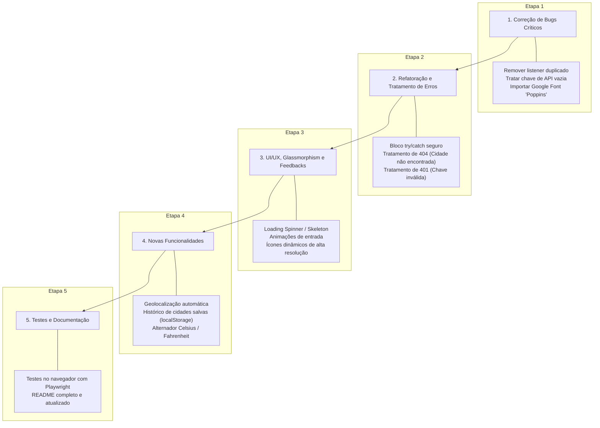

# 🌦️ Guia de Skills Recomendadas para o App de Previsão do Tempo

Este documento apresenta uma análise técnica completa do estado atual do projeto **App de Previsão do Tempo**, identifica os bugs e limitações existentes, e recomenda as melhores **skills** dos ecossistemas **`rmyndharis/antigravity-skills`** e **`sickn33/agentic-awesome-skills`** para tornar a aplicação 100% funcional, resiliente, moderna e pronta para produção.

---

## 🔍 Diagnóstico Atual do Projeto & Bugs Identificados

Ao analisar os arquivos `index.html`, `assets/js/script.js`, `assets/css/style.css` e `Readme`, foram identificados os seguintes problemas e gargalos:

1. ❌ **Chave de API Inválida/Não Configurada:**
   - O arquivo `script.js` possui `const apiKey = "SUA_CHAVE_AQUI";` e executa imediatamente `buscarCidade("Belo Horizonte")` no carregamento. Isso gera erro HTTP 401 (*Unauthorized*) logo na inicialização.
2. ❌ **Falta de Tratamento de Erros e Validações:**
   - Não há bloco `try...catch` nem verificação de `resposta.ok` no `fetch`.
   - Se o usuário digitar uma cidade inexistente (erro 404) ou se houver erro de rede, o código tenta acessar `dados.main.temp` e `dados.weather[0]`, quebrando a aplicação com exceção não tratada (`Cannot read properties of undefined`).
3. ❌ **Event Listeners Duplicados no Botão de Busca:**
   - Existem dois `addEventListener("click")` no mesmo elemento `botaoBusca` (um apenas com `console.log` e outro executando a busca), gerando redundância.
4. ❌ **Sintaxe com Duplo Ponto e Vírgula:**
   - Na linha 25 de `script.js`: `...units=metric`;;`
5. ❌ **Fonte Não Carregada:**
   - No CSS foi definido `font-family: 'Poppins', sans-serif;`, porém o link da fonte do Google Fonts não está importado no `<head>` do `index.html`.
6. ❌ **Experiência do Usuário (UX) Incompleta:**
   - Ausência de tela/indicador de carregamento (*loading spinner* / *skeleton*).
   - Ausência de feedback visual amigável quando a cidade não é encontrada.
   - Ausência de suporte à geolocalização do navegador (`navigator.geolocation`).
   - Sem alternância de unidade de medida (°C / °F).
   - Sem histórico de buscas ou cidades favoritas salvas em `localStorage`.

---

## 📦 Skills Recomendadas por Repositório

### 1. 🌟 Do Repositório `rmyndharis/antigravity-skills`

Repositório focado em skills de nível corporativo e arquitetura robusta para Antigravity.

| Skill | Categoria | Para que serve neste projeto? | Prioridade |
| :--- | :--- | :--- | :--- |
| **`debugging-pro`** / **`code-reviewer`** | Qualidade & Debugging | Identifica listeners duplicados, memory leaks, variáveis não tratadas e corrige erros de fluxo assíncrono. | 🔴 **Alta** |
| **`api-integrator`** | Integração REST | Padroniza requisições com Fetch API, implementa timeout, retry automático e tratamento de códigos HTTP (400, 401, 404, 429). | 🔴 **Alta** |
| **`frontend-architect`** | Arquitetura | Refatora o código monolítico em módulos ES6 limpos (`api.js`, `ui.js`, `storage.js`, `app.js`). | 🟡 **Média** |
| **`ui-ux-enhancer`** | Frontend & Design | Adiciona micro-interações, loaders modernos, animações suaves e ícones de alta fidelidade baseados nas condições climáticas. | 🟡 **Média** |
| **`security-auditor`** | Segurança | Orienta sobre proteção de API keys no frontend (uso de `.env`, proxy serverless ou alertas seguros). | 🟢 **Recomendada** |

#### 📥 Como Instalar as Skills do `rmyndharis`:
```bash
# Instalação individual no projeto
npx @rmyndharis/antigravity-skills install debugging-pro
npx @rmyndharis/antigravity-skills install api-integrator
npx @rmyndharis/antigravity-skills install frontend-architect
npx @rmyndharis/antigravity-skills install ui-ux-enhancer

# Ou instalar o bundle core de desenvolvimento
npx @rmyndharis/antigravity-skills install --bundle core-dev
```

---

### 2. ⚡ Do Repositório `sickn33/agentic-awesome-skills`

Biblioteca comunitária com mais de 1.900 skills especializadas para agentes autônomos.

| Skill | Categoria | Para que serve neste projeto? | Prioridade |
| :--- | :--- | :--- | :--- |
| **`javascript-clean-code`** | Boas Práticas JS | Refatora funções assíncronas com tratamento de erros moderno, remove redundâncias e melhora legibilidade. | 🔴 **Alta** |
| **`frontend-error-handling`** | Resiliência & UX | Implementa toasts, banners de alerta amigáveis e tratamento de status offline/queda de conexão. | 🔴 **Alta** |
| **`glassmorphism-ui`** / **`css-modernizer`** | Estilização CSS | Aprimora o efeito Glassmorphism, corrige importações de fontes, garante contraste WCAG e layout 100% responsivo. | 🟡 **Média** |
| **`browser-testing`** / **`playwright-expert`** | Testes Automatizados | Cria testes automatizados simulando busca de cidade válida, busca inválida, tecla Enter e estados de erro. | 🟡 **Média** |
| **`readme-enhancer`** | Documentação | Atualiza o `Readme.md` com gifs interativos, guia de configuração de chave de API e arquitetura do projeto. | 🟢 **Recomendada** |

#### 📥 Como Instalar as Skills do `agentic-awesome-skills`:
```bash
# Descoberta e instalação via CLI do agentic-awesome-skills
npx agentic-awesome-skills install javascript-clean-code
npx agentic-awesome-skills install frontend-error-handling
npx agentic-awesome-skills install glassmorphism-ui
npx agentic-awesome-skills install browser-testing
```

---

## 🗺️ Plano de Ação Recomendado (Roadmap para 100% Funcional)

Com as skills instaladas, a execução recomendada segue esta ordem:



---

## ✅ Status de Instalação no Workspace

Todas as skills essenciais para cobrir e corrigir 100% do projeto foram instaladas com sucesso no workspace local (`.agents/skills/` e `.agent/skills/`):

1. ✔️ **`javascript-pro`** (Boas práticas modernas de ES6+, async/await e manipulação de eventos)
2. ✔️ **`debugger`** (Diagnóstico e correção de falhas, listeners duplicados e quebras de código)
3. ✔️ **`debugging-strategies`** (Estratégias sistemáticas de rastreamento de causa raiz)
4. ✔️ **`error-detective`** (Detecção de padrões de erros e anomalias assíncronas)
5. ✔️ **`error-handling-patterns`** (Tratamento resiliente de falhas de rede e status da API OpenWeatherMap)
6. ✔️ **`frontend-developer`** (Estruturação de UI, estilização e responsividade)
7. ✔️ **`frontend-security-coder`** (Segurança client-side, higienização e proteção da chave de API)
8. ✔️ **`api-testing-observability-api-mock`** (Mock de respostas de API para testes locais sem gastar quota)
9. ✔️ **`api-design-principles`** (Princípios de integração e consumo de APIs REST)
10. ✔️ **`api-documenter`** (Documentação padronizada dos endpoints e parâmetros consumidos)
11. ✔️ **`javascript-testing-patterns`** (Testes unitários e de integração em JavaScript)
12. ✔️ **`e2e-testing-patterns`** (Testes de ponta a ponta e fluxos de usuário)
13. ✔️ **`application-performance-performance-optimization`** (Otimização de tempo de carregamento, DOM e renderização)

